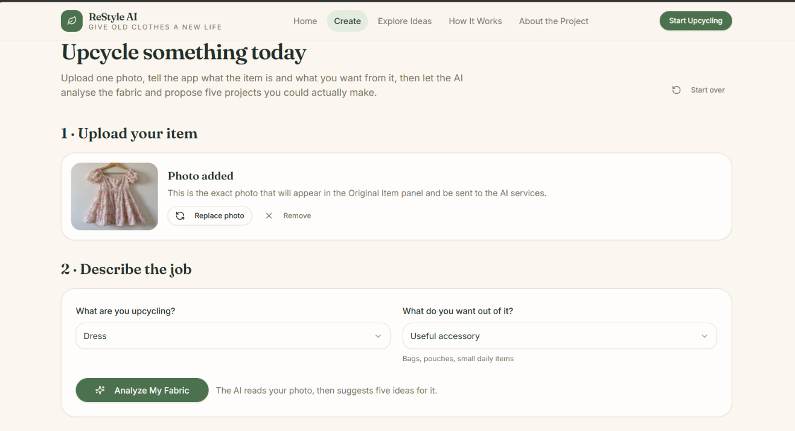
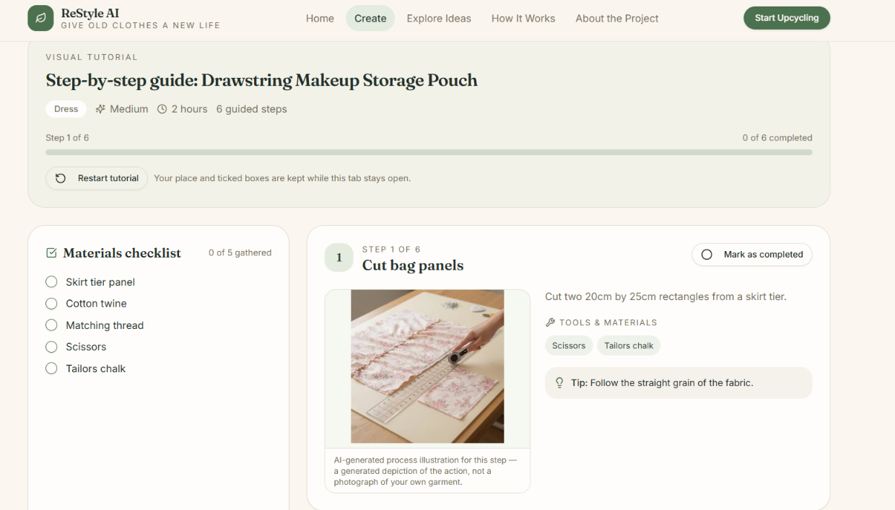

# ReStyle-AI
AI-powered old clothes redesign and upcycling platform.

# ♻️ ReStyle AI

### AI-Powered Clothing Redesign and Upcycling Platform

ReStyle AI is an AI-powered web application that transforms old, unused clothes and fabrics into creative and useful products. It provides redesign suggestions, generates redesigned product images, and offers step-by-step visual DIY tutorials.

## 🌐 Live Project

[Click Here to Explore ReStyle AI](https://restyle-thread-lab.base44.app)

## 🎯 Project Objective

The main objective of ReStyle AI is to promote sustainable fashion by encouraging people to reuse old clothes instead of throwing them away. The platform uses AI-powered suggestions to turn unused fabrics into creative and practical products.

## ❗ Problem Statement

- Increasing textile waste and environmental pollution.
- Lack of awareness about clothing reuse.
- Difficulty finding creative upcycling ideas.
- Lack of proper DIY guidance.
- No single platform for redesign suggestions and visual tutorials.

## 💡 Proposed Solution

ReStyle AI provides an AI-powered platform where users can upload old clothing images, explore creative redesign possibilities, generate redesigned product images, and follow visual DIY instructions.

## ✨ Key Features

- Upload images of old clothes or fabrics.
- Analyze the uploaded clothing.
- Identify five clothing features.
- Generate five suitable upcycling possibilities.
- Provide creative redesign ideas.
- Generate redesigned product images.
- Display required materials.
- Provide step-by-step DIY instructions.
- Show visual illustrations for tutorial steps.

## ⚙️ How It Works

1. Upload an image of old clothing.
2. Click the Analyze My Fabric option.
3. AI analyzes the uploaded clothing.
4. View five upcycling possibilities.
5. Select a preferred redesign idea.
6. Generate the redesigned product image.
7. View the required materials and DIY instructions.
8. Follow the visual step-by-step tutorial.

## 🖥️ Project Screenshots

### 1. Clothing Upload Page

### 2. AI Suggestions

### 3. AI Redesign Result

### 5. Materials and DIY Tutorial

## 🎥 Project Demo Video

[Watch the ReStyle AI Project Demo](https://drive.google.com/file/d/1lLNtcetYRT5ebg9pt1xJqZWg0Yzd6958/view?usp=sharing)

## 🛠️ Technologies Used

- Base44 – Application development platform.
- Artificial Intelligence – Redesign suggestions and image generation.
- Web Technologies – Web application interface.

## 🌱 Benefits

- Encourages sustainable fashion.
- Reduces textile waste.
- Promotes clothing reuse.
- Provides creative upcycling ideas.
- Makes DIY redesign easier.
- Supports environmental awareness.

## 🚀 Future Enhancements

- Development of a mobile application.
- More clothing redesign categories.
- Improved AI-based recommendations.
- Additional DIY tutorial options.
- Enhanced user experience.

## 🎯 Conclusion

ReStyle AI provides a creative and innovative approach to sustainable fashion by transforming old and unused clothes into useful products. The platform combines AI-powered redesign suggestions, image generation, material recommendations, and visual DIY tutorials in one place. It encourages clothing reuse, reduces textile waste, and promotes environmental sustainability.

## 👩‍💻 Project Information

**Project Name:** ReStyle AI

**Domain:** Artificial Intelligence

**Project Type:** Web-Based Application

**Development Platform:** Base44

**Application:** ReStyle AI
